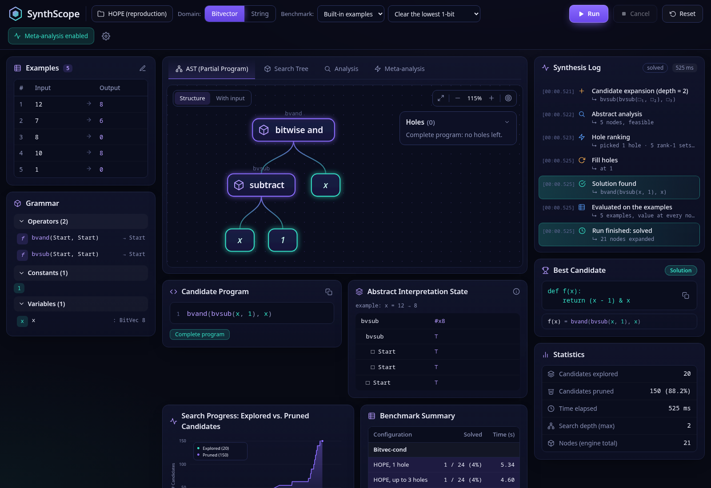
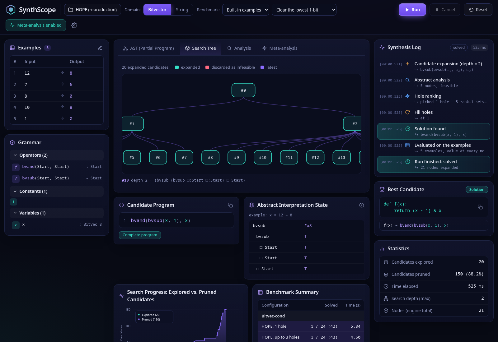
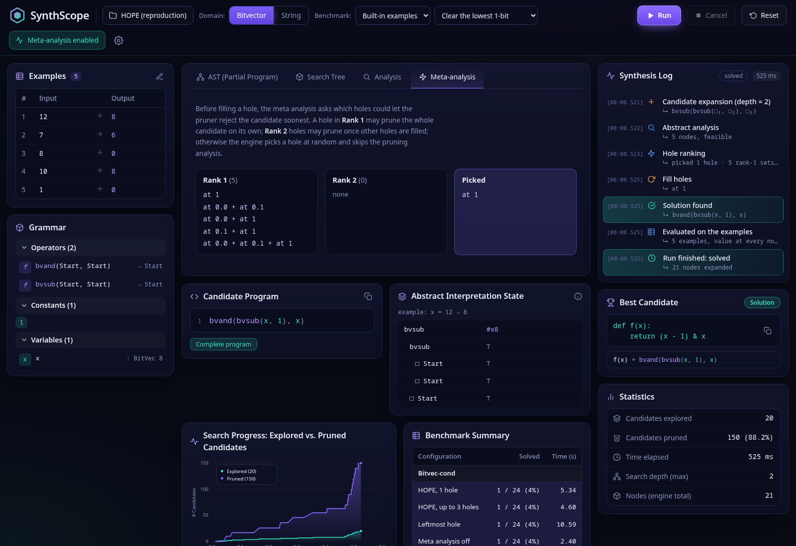

# SynthScope

An independent Python reimplementation of **HOPE** (Lee, Lee & Yi, [*Inductive Program Synthesis by Meta-Analysis-Guided
Hole Filling*](research/sources/hanyang/popl26.pdf), POPL 2026) for bitvectors and strings, with a SvelteKit dashboard that shows a synthesis run live.

HOPE synthesizes a program from input/output examples by growing a partial program with holes. Before filling a hole it
runs a *meta analysis* to pick the hole that lets an abstract-interpretation pruner reject the candidate soonest.
SynthScope implements the search, the abstract domains and the meta analysis, and lets you watch each step.

The engine is the deliverable. The dashboard only draws events the engine emitted.

## Dashboard

Every view below comes from one run that synthesizes "clear the lowest 1-bit" (`bvand(bvsub(x, 1), x)`) from five examples.

**Partial program.** The AST under construction, with the open holes. "With input" shows the value at every node for a chosen example.



**Search tree.** Every expanded candidate, and those discarded as infeasible.


**Analysis.** The abstract value computed for each node of the candidate.



**Meta analysis.** Holes ranked by how soon they may let the pruner reject the candidate, and the one picked.



## Setup

Requires Python 3.12+ and Node.js.

```bash
uv venv --python 3.12 .venv && uv pip install -p .venv/bin/python -e '.[dev]'
cd apps/web && npm install
```

## Run the dashboard

```bash
.venv/bin/uvicorn apps.api.main:app --port 8000
cd apps/web && npm run dev
```

Open http://localhost:5173. Set `API_URL=http://localhost:PORT` if the API runs on another port.

## Command line

```bash
.venv/bin/python -m hope_engine.cli solve tests/sygus/fixtures/bv.sl --policy hope --holes 3
.venv/bin/python -m hope_engine.cli bench tests/sygus/fixtures --policy leftmost --out results/leftmost.jsonl
.venv/bin/python -m hope_engine.cli report results/*.jsonl
```

Policies: `hope` (meta analysis), `leftmost`, `meta_off` (random hole). Problems are SyGuS-IF files.

## Benchmarks

The paper's corpora (Duet, Bitvec-cond, Deobfusc, Hacker's Delight) are GPL and not committed:

```bash
scripts/fetch_benchmarks.sh
scripts/run_paper_ablations.sh duet 20 50000 24 0     # dir, timeout s, node cap, sample size, seed
```

Hacker's Delight solutions are checked with Z3. At the sampled budget in `results/README.md` the four configurations
solve nearly the same problems, so this repository makes no claim of reproducing the paper's reported gains.

## Tests

```bash
.venv/bin/pytest -q
cd apps/web && npx vitest run
```

## Layout

| Path | Contents |
|---|---|
| `src/hope_engine/` | engine: syntax, concrete semantics, abstract domains, meta analysis, enumeration, SyGuS import, benchmarks |
| `apps/api/` | FastAPI + websocket server streaming engine events |
| `apps/web/` | SvelteKit 5 dashboard |
| `research/` | paper mapping, operator matrix, known deviations from the paper |
| `results/` | ablation tables |
| `scripts/` | benchmark download and ablation runners |
